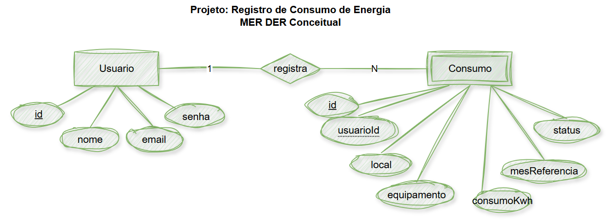
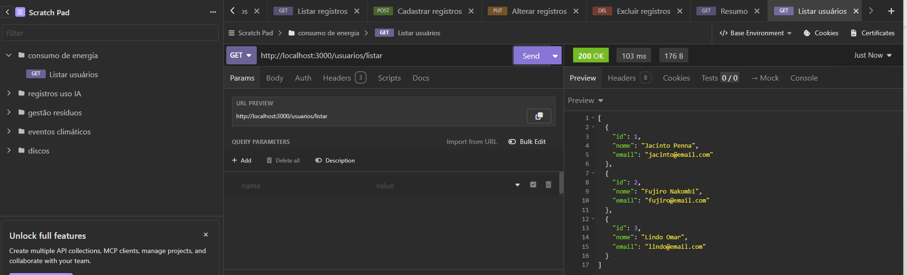
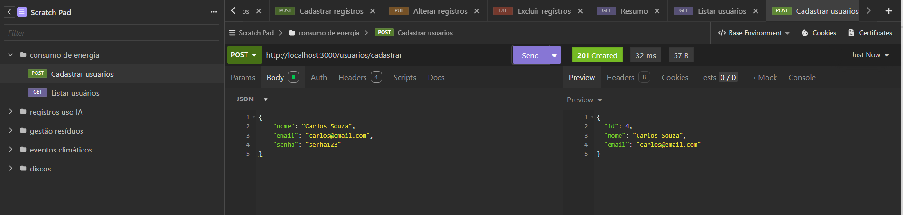
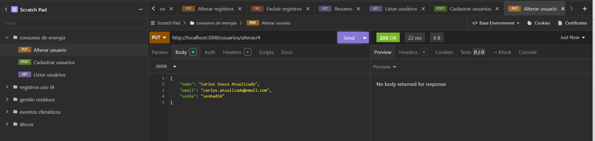
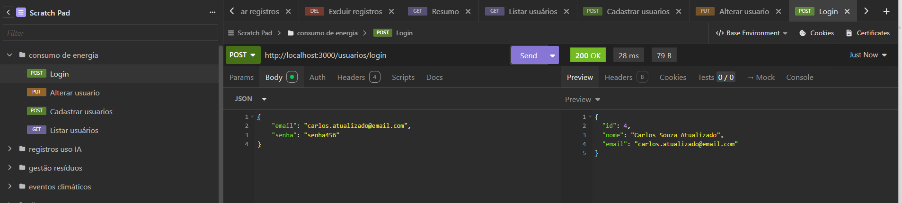
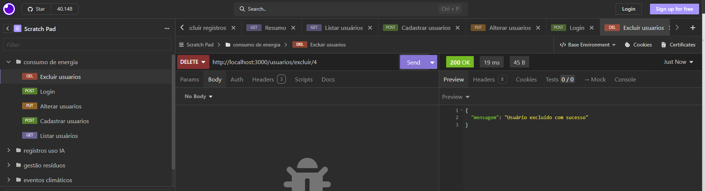
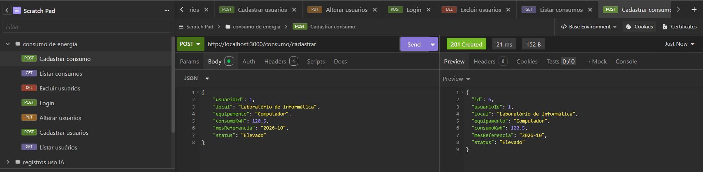
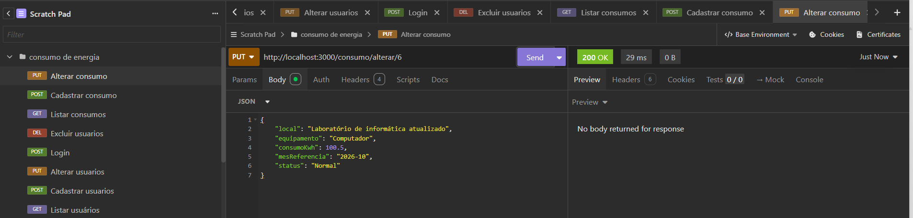
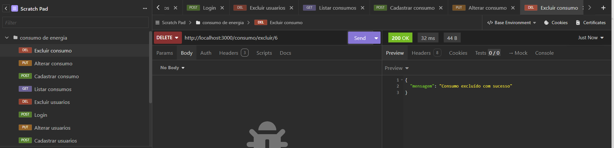
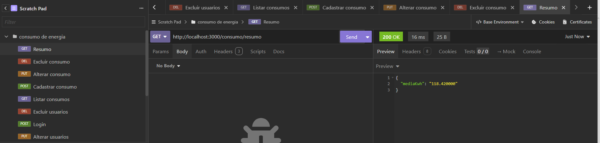

# Registro de Consumo de Energia

## Descrição

Sistema desenvolvido para o SESI com o objetivo de registrar equipamentos e locais, acompanhar o consumo de energia elétrica e identificar possíveis desperdícios energéticos.

O sistema permite cadastrar usuários, realizar login, registrar consumos de energia, consultar informações, alterar e excluir registros, além de calcular a média de consumo em kWh.

## MER DER Conceitual

## Tecnologias Utilizadas

- Node.js
- Express
- MariaDB
- MySQL2
- JavaScript
- Insomnia
- Visual Studio Code
- XAMPP
- Git e GitHub

## Testes com Insomnia

Os testes foram realizados utilizando o Insomnia, verificando as operações de cadastro, listagem, alteração, exclusão, login e consulta da média de consumo.

### Usuários

**Listar usuários**

**Cadastrar usuário**

**Alterar usuário**

**Login**

**Excluir usuário**

### Consumo de Energia

**Listar consumos**

**Cadastrar consumo**

**Alterar consumo**

**Excluir consumo**

### Resumo da Média de Consumo

